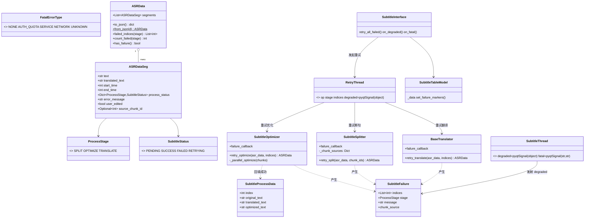
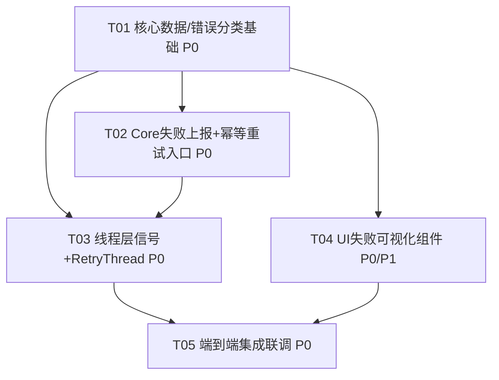

# 架构设计：字幕处理失败的重试机制 + 前端失败提示 + 结果区手动重试按钮

- 项目：VideoCaptioner（Python + PySide6 / QFluentWidgets 桌面字幕工具）
- 架构师：高见远（Gao）
- 关联 PRD：`docs/prd_failure_retry.md`（许清楚）
- 文档版本：v1.1（功能落地后同步实际实现状态）

> 阅读对象：工程师。本文档给出可直接落地的设计：数据结构变更、失败上报链路、幂等重试入口、UI 交互、调用时序、任务分解，以及对 PRD 9 节 6 条待确认问题的架构决策建议。

> **⚠️ 实现落地状态（v1.1 同步）**：本设计已落地，但实际实现相对 v1.0 设计稿有如下裁剪/调整，阅读时以下述实际状态为准：
>
> - ✅ **已实现**：
>   - 数据结构全套：`ProcessStage` / `SubtitleStatus` / `SubtitleFailure`（`core/entities.py`）；`ASRDataSeg` 状态字段 + `failed_indices`/`count_failed`/`has_failure`（`core/asr/asr_data.py`）。
>   - 错误分类：`FatalErrorType` + `classify_error`（`core/utils/error_classifier.py`）。
>   - 优化 / 翻译的失败上报 + 幂等重试：`retry_optimize` / `retry_translate`（core 层）。
>   - 线程层：`SubtitleThread.degraded`/`fatal` 信号 + `_collect_failure`；`RetryThread`（仅优化/翻译两阶段）。
>   - UI：结果区失败行着色 + tooltip + 「重试全部失败项(N)」按钮 + 单条重试接线。
>   - 测试：`tests/test_subtitle/test_retry_interface.py`（T05 端到端离屏联调）。
> - ❌ **未实现（设计有、落地裁剪）**：
>   - **断句重试 `retry_split`**（见 §4.1、类图 `SubtitleSplitter.retry_split`）—— 断句失败仍走整体重跑，未做按 chunk 幂等重试；`ASRDataSeg.user_edited` / `source_chunk_id` 字段已预留，但断句重试逻辑未接。
>   - **P1 组件抽取**（§7 `subtitle_table_model.py` / `subtitle_status_delegate.py`）—— `SubtitleTableModel` 仍内联在 `subtitle_interface.py`，未抽独立文件；失败行着色在 interface 内实现，未拆独立 delegate 文件。
> - 📍 **位置调整**：`FatalErrorType` / `classify_error` 落在 `core/utils/error_classifier.py`（见 §2.2），**未**并入 `entities.py`（§2.1 类图与 §7 表格中的 entities 归属以本条为准）。

---

## Part A — 系统设计

### 1. 实现方案与技术选型

#### 1.1 核心技术挑战

1. **失败状态需要在「处理线程」和「UI 线程」之间安全传递**：批量优化/翻译在 `ThreadPoolExecutor` 中并发执行，失败项产生于工作线程，必须通过 Qt 信号（跨线程 queued connection）冒泡到 UI 线程，不能直接操作 `QAbstractTableModel`。
2. **幂等重试需要持久化的「每条成功/失败」状态**：现有 `ASRDataSeg` 只有文本字段，重试时无法区分「哪条失败、哪条成功」，也无法只重发失败项。需要在数据结构上记录 stage 级状态，且该状态必须能随 `to_json()` / `from_json()` 在结果区与 `ASRData` 之间往返而不丢失。
3. **三类操作的失败粒度不同**：断句按 chunk（段）失败，优化/翻译按条/批失败。重试入口必须与粒度匹配，且断句重试涉及「源 word 级数据在合并后会丢失」的难点。
4. **不能重跑已成功项**：这是硬约束（省 token / 额度）。重试入口必须「只构造失败项的子集」喂给 LLM，成功项的原文本原样保留。

#### 1.2 技术选型（复用现有栈，不引入新框架）

| 关注点 | 选型 | 理由 |
|--------|------|------|
| 跨线程失败上报 | Qt 信号槽（新增 `degraded = pyqtSignal(object)`） | 与现有 `error` / `update` / `update_all` 信号完全一致的模式；`object` 类型可承载 Python 对象列表（同进程 queued connection 安全） |
| 状态建模 | `enum.Enum`（`SubtitleStatus` / `ProcessStage`）+ `ASRDataSeg` 新增字段 | 轻量、无依赖，随 `ASRData` 序列化 |
| 失败收集 | core 层回调 `failure_callback`（镜像现有 `update_callback`） | 现有 `SubtitleOptimizer` / `BaseTranslator` 已用 `update_callback` 上报进度，失败上报用对称的回调，改动最小、风格统一 |
| 手动重试执行 | 新增 `RetryThread(QThread)`，复用 `RetranslateThread` 模式 | 项目已有 `RetranslateThread`（选中行重翻译）这一「只重跑子集」的成熟先例，直接沿用其「构建子 `ASRData` → 跑 → 回填」范式 |
| UI 失败标注 | `QStyledItemDelegate` + `Qt.BackgroundRole`/`ForegroundRole` | `SubtitleTableModel` 是标准 `QAbstractTableModel`，用 delegate 画失败角标/重试按钮 + 数据角色着色，是 Qt 原生做法 |
| 通知 | qfluentwidgets `InfoBar.error`（致命）/ `InfoBar.warning`（汇总） | 链路已通，直接复用 |
| 自动重试 | 现有 tenacity（LLM client）+ agent loop（`MAX_STEPS`） | 保持不变，仅微调断句 `MAX_STEPS` |

#### 1.3 架构模式

沿用项目既有的 **分层 + Qt 信号槽** 模式（非严格 MVC）：

```
[Core 层]  ASRData / Optimizer / Splitter / Translator
     │  产生 FailureReport（回调）
     ▼
[Thread 层] SubtitleThread / RetryThread（QThread）
     │  跨线程信号：degraded / fatal / progress / finished
     ▼
[UI 层]  SubtitleInterface + SubtitleTableModel + Delegate
          InfoBar.error(致命) / InfoBar.warning(汇总) / 结果区失败标注 + 重试按钮
```

设计原则：**core 层只负责「记录并回调失败」，不做任何 UI 假设；thread 层负责把失败打包成信号；UI 层负责展示与发起重试。** 三层解耦，core 可被 CLI 复用。

---

### 2. 数据结构变更（核心：ASRData 记录每条成功/失败状态）

这是整个设计的基础。**目标：让每条字幕在每个处理阶段（断句/优化/翻译）都有可持久化、可往返的成功/失败状态，从而同时支撑「失败可视化」和「幂等重试（只重发失败项）」。**

#### 2.1 新增枚举与数据类（`core/entities.py`）

```python
class ProcessStage(str, Enum):
    """处理阶段，失败按阶段记录"""
    SPLIT = "split"
    OPTIMIZE = "optimize"
    TRANSLATE = "translate"

class SubtitleStatus(str, Enum):
    """单条字幕在某阶段的状态"""
    PENDING = "pending"    # 未处理（默认）
    SUCCESS = "success"    # 处理成功
    FAILED = "failed"      # 降级失败（主流程继续）
    RETRYING = "retrying"  # 手动重试中

@dataclass
class SubtitleFailure:
    """一次降级失败的记录，用于跨线程上报与 UI 标注"""
    indices: List[int]          # 受影响的字幕 index（1-based，与 ASRData.segments 对应）
    stage: ProcessStage
    message: str = ""
    # 断句失败额外携带：受影响 chunk 的源 word 级数据，供整段重试
    chunk_source: Optional[Any] = None
```

> 说明：`SubtitleProcessData`（现有）继续作为「成功项回填」载体；`SubtitleFailure` 作为对称的「失败项上报」载体。

#### 2.2 致命错误分类（新增 `core/utils/error_classifier.py`）

```python
class FatalErrorType(str, Enum):
    NONE = "none"
    AUTH_QUOTA = "auth_quota"      # 403 / 欠费 / 余额不足 —— 不可自动重试
    SERVICE_UNAVAILABLE = "service" # 503 / 服务不可用 —— 条件恢复
    NETWORK = "network"            # 网络中断
    UNKNOWN = "unknown"

def classify_error(exc_or_msg) -> FatalErrorType:
    """从异常/错误文本识别致命错误类别，供 UI 决定是否禁用手动重试"""
    ...  # 关键字匹配：403/quota/insufficient/balance → AUTH_QUOTA；503/unavailable → SERVICE
```

#### 2.3 `ASRDataSeg` 新增字段

```python
class ASRDataSeg:
    def __init__(self, text, start_time, end_time, translated_text=""):
        self.text = text
        self.translated_text = translated_text
        self.start_time = start_time
        self.end_time = end_time
        # —— 新增 ——
        # 每阶段状态：{ProcessStage.SPLIT: SubtitleStatus.SUCCESS, ...}
        # 只记录「已被处理过的阶段」，未出现的阶段视为 PENDING
        self.process_status: Dict[ProcessStage, SubtitleStatus] = {}
        self.error_message: str = ""      # 最近一次失败原因（可选，用于 tooltip）
        self.user_edited: bool = False    # 用户是否手动编辑过（支撑断句重试覆盖确认，见 §10-Q4）
        self.source_chunk_id: Optional[int] = None  # 断句阶段：本条来自哪个 chunk（支撑断句重试）
```

> 关键点：`process_status` 是 **per-stage 的字典**而非单一 status。因为一条字幕可能「断句成功、优化失败」，重试优化时不应触碰断句结果。断句失败的标注落到该 chunk 产出的所有 segment 上（见 §4.1）。

#### 2.4 `ASRData` 变更

```python
class ASRData:
    # to_json() 输出增加 status，使 UI 表格能读到失败标记
    def to_json(self) -> dict:
        result_json = {}
        for i, seg in enumerate(self.segments, 1):
            result_json[str(i)] = {
                "start_time": seg.start_time,
                "end_time": seg.end_time,
                "original_subtitle": seg.text,
                "translated_subtitle": seg.translated_text,
                # —— 新增：仅序列化 FAILED 状态（成功为默认，省空间）——
                "failed_stages": [s.value for s, st in seg.process_status.items()
                                  if st == SubtitleStatus.FAILED],
                "error_message": seg.error_message,
            }
        return result_json

    # from_json() 读取 status，使重试前能重建 ASRData 并保留失败标记
    @staticmethod
    def from_json(json_data: dict) -> "ASRData":
        ...  # 解析 failed_stages → 还原 process_status

    # 新增：取某阶段失败项 index 列表（幂等重试的核心查询）
    def failed_indices(self, stage: ProcessStage) -> List[int]:
        return [i for i, seg in enumerate(self.segments, 1)
                if seg.process_status.get(stage) == SubtitleStatus.FAILED]

    # 新增：统计某阶段失败数量（UI 汇总按钮 "重试全部失败项(N)"）
    def count_failed(self, stage: ProcessStage) -> int: ...
    def has_failure(self) -> bool: ...
```

#### 2.5 类图（Mermaid）



---

### 3. 失败上报机制（core → thread → UI）

改造原则：**把三处「静默吞掉 / 仅 logger」的降级点，改为「记录失败 + 计数 + 回调上报」，主流程仍继续（保持优雅降级），但失败不再对用户不可见。**

#### 3.1 core 层：新增对称的 `failure_callback`

`SubtitleOptimizer` / `SubtitleSplitter` / `BaseTranslator` 的 `__init__` 各新增可选参数 `failure_callback: Optional[Callable[[SubtitleFailure], None]] = None`，与现有 `update_callback` 对称。core 层只调用回调，不 import 任何 UI。

#### 3.2 三处降级点改造

**(a) 断句 `split_by_llm.py`** —— 当前 `except: return [text]`。
- 改为返回 `(result, ok_flag)` 或在彻底失败（连 rules 都没用、退回原文 `[text]`）时通过回调上报失败。
- 注意：`split.py` 已有 `_process_by_rules` 兜底，所以「断句降级失败」的真正语义是 **整段 chunk 连 LLM + rules 都无法正确切分，最终退回原文单条**。上报点放在 `_process_single_segment` 判定「走了降级路径且结果等于原文」时。
- 失败粒度 = chunk。`SubtitleSplitter` 维护 `_chunk_sources[chunk_id] = 源 word 级 ASRData 片段` 与输出 segment 的 `source_chunk_id`，失败时携带 `chunk_source`，供整段重试（见 §4.1）。

**(b) 优化 `optimize.py`**
- `_parallel_optimize` 的 `except`（148-149，批失败）：原来只 `logger.error` + `optimized_dict.update(chunk)`。改为：对该批所有 index 打 `process_status[OPTIMIZE]=FAILED`，并 `failure_callback(SubtitleFailure(indices, OPTIMIZE, msg))`，仍保留原文继续。
- `_optimize_chunk` 的 `except`（183-184，单条/批失败）：同样打 FAILED + 上报。
- 顶层 `optimize_subtitle` 的 `raise RuntimeError`（101-103）：这是致命失败，保持 raise，由 thread 层 `error.emit` 走既有 `InfoBar.error` 链路，同时经 `classify_error` 标注致命类型。

**(c) 翻译 `translate/base.py`**
- `_parallel_translate` 的 `except`（chunk 失败，98-100）：对该 chunk index 打 `process_status[TRANSLATE]=FAILED` + 上报，仍保留原文。
- 现有 `fail_rate >= 0.5 → raise`（103-109）保留：这是致命/大面积失败，走 `InfoBar.error`。但大面积失败也应让用户能重试 —— 见 §10-Q5（403 时禁用）。
- `_set_segments_translated_text` 中「segment has no translation」（159）也打 FAILED + 上报。

#### 3.3 thread 层：失败打包为跨线程信号

`SubtitleThread` 新增信号：

```python
class SubtitleThread(QThread):
    # ……现有 finished/progress/update/update_all/error……
    degraded = pyqtSignal(object)   # List[SubtitleFailure]，子任务降级失败集合
    fatal     = pyqtSignal(str, str) # (error_text, FatalErrorType.value)，致命失败（复用 error，但带类型）
```

- `SubtitleThread` 在 `__init__` 里把 `failure_callback=self._collect_failure` 传给 Optimizer/Splitter/Translator。
- `_collect_failure(f: SubtitleFailure)` 把失败追加到 `self._failures: List[SubtitleFailure]`，并 `self.degraded.emit([f])`（逐条实时发射，UI 可即时标注；也可批量结束时统一 emit 汇总，二选一，建议实时 emit + 结束时再 emit 一次累计汇总）。
- 致命失败：`run()` 的 `except` 里，先 `fatal_type = classify_error(e)`，再 `self.error.emit(str(e))`（保持向后兼容），并 `self.fatal.emit(str(e), fatal_type.value)`。

> 信号类型用 `pyqtSignal(object)` 承载 Python 对象列表：Qt 的 queued connection 会用默认拷贝，同进程内传 `List[SubtitleFailure]` 安全（项目已用 `pyqtSignal(dict)` 传 `update_all`，同理）。

#### 3.4 失败项集合的传递链

```
Optimizer/Splitter/Translator(工作线程)
   │ failure_callback(SubtitleFailure)
   ▼
SubtitleThread._collect_failure  →  self._failures 累积
   │ degraded.emit(List[SubtitleFailure])   (跨线程 queued)
   ▼
SubtitleInterface.on_degraded(failures)
   │ 写入 model._data[key]["failed_stages"] → dataChanged
   ▼
SubtitleTableModel 重绘失败标注（§6）
```

---

### 4. 手动重试机制（核心层入口，保证幂等）

幂等铁律：**重试入口只把「失败项子集」构造为新的 `ASRData` 喂给 LLM，成功项的原文本原样保留、不参与重发。** 重试成功 → 更新该条文本 + 状态改 `SUCCESS`；仍失败 → 状态保持 `FAILED`，并再次上报。

> **⚠️ 落地范围（v1.1）**：实际实现仅覆盖 **§4.2 优化重试** 与 **§4.3 翻译重试**（`RetryThread` 仅含 OPTIMIZE / TRANSLATE 两阶段）。**§4.1 断句重试 `retry_split` 未实现**（断句失败仍走整体重跑），下述 §4.1 为设计保留，供后续迭代参考。

#### 4.1 断句重试：`SubtitleSplitter.retry_split(asr_data, chunk_ids)`

- 断句无法按单条重试，必须 **整段（chunk）重来**。
- 依赖 §3.2(a) 保留的 `_chunk_sources[chunk_id]`（源 word 级片段）与 segment 的 `source_chunk_id`。
- 重试流程：对每个 `chunk_id`，取源 word 级片段 → 只跑 LLM 路径 `_process_by_llm`（可带 `MAX_STEPS` 反馈循环）→ 用新产出替换掉原 chunk 产出的那些 segment（按 `source_chunk_id` 定位）→ 成功则清 `SPLIT` 的 FAILED，失败则保持。
- **覆盖策略**见 §10-Q4：整段重试会丢弃该段用户已编辑结果，需二次确认。

#### 4.2 优化重试：`SubtitleOptimizer.retry_optimize(asr_data, indices)`

```python
def retry_optimize(self, asr_data: ASRData, indices: List[int]) -> ASRData:
    """只重试指定 index 的优化；成功项原样保留。
    幂等：indices 之外的字幕不参与；返回的 ASRData 只在 indices 上可能变化。"""
    # 1) 从 asr_data 抽取 indices 对应的 segments 构造「子 ASRData」
    #    （复用 RetranslateThread 已验证的 from_json 子集模式）
    # 2) 只对子集跑 _split_chunks + _parallel_optimize
    # 3) 把结果按 index 回填到原 asr_data 的对应 segment，
    #    成功 → 文本更新 + process_status[OPTIMIZE]=SUCCESS；失败 → 保持 FAILED + 再次上报
    return asr_data
```

#### 4.3 翻译重试：`BaseTranslator.retry_translate(asr_data, indices)`

- 与 `retry_optimize` 同构。实际上 **现有 `RetranslateThread` 已实现了「选中行重翻译」的核心逻辑**（构建选中行子 `ASRData` → `translate_subtitle` → 回填），`retry_translate` 可直接复用/抽提该逻辑，把「选中行」换成「失败行」。
- 注意翻译有 cache（`_get_cache_key`）：失败项重试会因原 chunk 未成功而 cache miss，天然不会误命中成功项缓存，幂等安全。

#### 4.4 与已成功项的隔离保证

| 机制 | 保证 |
|------|------|
| 子集 `ASRData` 构造 | 重试只喂失败 index，成功项根本不进入 LLM 请求 |
| `process_status` per-stage | 重试优化不触碰断句/翻译结果 |
| 文本回填按 index | 只覆盖失败项的文本槽位 |
| 翻译 cache key 按 chunk 文本 | 成功项不会被失败项重试误命中 |

#### 4.5 并发与退避（重试专用）

`retry_*` 入口支持覆盖并发度：`retry_optimize(..., thread_num=None)`。**「重试全部失败项」建议强制串行（thread_num=1）或小并发 + 批间退避**，理由见 §10-Q2。单条精修可即时并发=1 执行。

---

### 5. UI 层（结果区失败标注 + 就地重试 + 汇总）

结果区 = `SubtitleInterface` 中的 `subtitle_table` + `SubtitleTableModel`。现状：4 列（开始/结束/字幕内容/翻译字幕），数据来自 `to_json()`。

#### 5.1 失败标注（`SubtitleTableModel`）

- `to_json()` 已新增 `failed_stages` / `error_message`（§2.4），模型据此渲染。
- **着色**：`data()` 响应 `Qt.BackgroundRole` / `Qt.ForegroundRole` / `Qt.ToolTipRole` —— 失败行浅红底 + 失败列红字；tooltip 显示 `error_message`。
- **状态标记**：在「翻译字幕」列（或新增窄「状态」列）以红色角标 / 「失败」文本标注。建议 P0 用**行着色 + 文字标签**（改动小），P1 再加精致角标。
- 新增 `set_failure_markers(indices, stage)`：批量写入 `_data[key]["failed_stages"]` 并 `dataChanged.emit` 局部刷新。

#### 5.2 就地重试（P1）

- 新增 `SubtitleStatusDelegate(QStyledItemDelegate)`：对失败行的操作列绘制一个小「重试」按钮（`FIF.SYNC` 图标），点击 → `retry_single(index, stage)`。
- 备选（更省代码，P0 可先用）：失败行**右键菜单**增加「重试此条」，复用现有 `show_context_menu`（已有「重新翻译」先例）。

#### 5.3 「重试全部失败项(N)」按钮（P0）

- 结果区工具条新增按钮 `retry_all_button`：文案「重试全部失败项(N)」，N 动态 = 当前失败总数；无失败时隐藏/置灰。
- 点击 → 收集各阶段失败 index → 创建 `RetryThread`（按阶段分别或合并重试）→ 走 §5.4 信号回填。
- 重试期间置灰开始/重试按钮（避免并发数据竞争，见 §10-Q3）。

#### 5.4 汇总 InfoBar.warning + 信号接线

- 批量结束（`on_subtitle_optimization_finished`）时，若 `asr_data.has_failure()`，弹 `InfoBar.warning("N 项处理失败，可在结果区重试", ...)`，可带「重试全部失败项」动作按钮（点击定位/触发 §5.3）。
- `RetryThread` 信号接线（镜像 `RetranslateThread`）：
  - `progress` → `on_subtitle_optimization_progress`（重试进度，P2 显示「重试中 3/10」）
  - `finished(results)` → `model.update_data`（只回填重试项，`update_data` 已按 key 精确更新）
  - `degraded(failures)` → 仍失败的项重新标注
  - `error(text, fatal_type)` → 致命失败弹窗；`AUTH_QUOTA` 时**禁用重试按钮**（§10-Q5）

#### 5.5 致命失败弹窗

- 复用 `on_subtitle_optimization_error` 的 `InfoBar.error`。
- 增强：根据 `fatal_type` 定制文案与按钮 —— `AUTH_QUOTA` →「余额不足，请充值后重试」且**重试按钮置灰/需先连通性检查**；`SERVICE_UNAVAILABLE` →「服务暂不可用，稍后重试」。
- 需要更强交互时用 `MessageBoxBase`（原因 + 重试/取消）。

---

### 6. 调用流程时序图

#### 6.1 批量优化 → 部分失败 → 汇总 → 「重试全部失败项」→ 只重发失败项

```mermaid
sequenceDiagram
    autonumber
    participant U as 用户
    participant UI as SubtitleInterface
    participant ST as SubtitleThread
    participant OPT as SubtitleOptimizer
    participant LLM as LLM API
    participant M as SubtitleTableModel
    participant RT as RetryThread

    U->>UI: 点击「开始」
    UI->>ST: start()
    ST->>OPT: optimize_subtitle(asr_data) [failure_callback=collect]
    par 并发批次
        OPT->>LLM: 优化 chunk1..N
        LLM-->>OPT: chunk1 成功
        OPT-->>ST: update_callback(成功项)
        ST-->>UI: update(dict) → M.update_data
    and
        LLM-->>OPT: chunk5 抛异常(自动重试仍失败)
        OPT->>OPT: chunk5 indices 打 FAILED
        OPT-->>ST: failure_callback(SubtitleFailure{5, OPTIMIZE})
        ST-->>UI: degraded.emit([failure])
        UI->>M: set_failure_markers([5]) → 行标红
    end
    ST-->>UI: finished.emit
    UI->>UI: asr_data.has_failure()=True
    UI-->>U: InfoBar.warning「1 项失败，可重试」 + 工具条「重试全部失败项(1)」

    U->>UI: 点击「重试全部失败项(1)」
    UI->>UI: 置灰开始/重试按钮(锁定编辑)
    UI->>RT: new RetryThread(OPTIMIZE, indices=[5], thread_num=1); start()
    RT->>OPT: retry_optimize(asr_data_subset, [5])
    OPT->>LLM: 只发 index=5（成功项不参与=幂等）
    LLM-->>OPT: index5 优化成功
    OPT-->>RT: 回填 index5 文本 + 状态 SUCCESS
    RT-->>UI: finished({5: new_text})
    UI->>M: update_data({5:new_text}) + 清除 index5 失败标记
    UI-->>U: InfoBar.success「重试完成」 + 解锁编辑
```

#### 6.2 幂等重试核心（retry_optimize）

```mermaid
sequenceDiagram
    autonumber
    participant RT as RetryThread
    participant OPT as SubtitleOptimizer
    participant AD as ASRData
    participant LLM as LLM API

    RT->>AD: failed_indices(OPTIMIZE) → [5,9]
    RT->>AD: 构造子集 ASRData(仅 5,9)
    RT->>OPT: retry_optimize(subset, [5,9], thread_num=1)
    OPT->>LLM: 仅重发 5,9 的文本
    LLM-->>OPT: 5 成功 / 9 仍失败
    OPT->>AD: 回填 5 文本, status[OPT]=SUCCESS
    OPT->>AD: 9 保持 status[OPT]=FAILED
    OPT-->>RT: degraded(SubtitleFailure{9})
    RT-->>RT: finished({5:...})
```

---

## Part B — 任务分解

### 7. 文件列表及相对路径

**修改（Modify）**

| 文件 | 变更要点 | 状态 |
|------|----------|------|
| `videocaptioner/core/entities.py` | 新增 `ProcessStage` / `SubtitleStatus` / `SubtitleFailure`（`FatalErrorType` 改落 `error_classifier.py`，见下） | ✅ 已实现 |
| `videocaptioner/core/asr/asr_data.py` | `ASRDataSeg` 新增 `process_status`/`error_message`/`user_edited`/`source_chunk_id`；`to_json`/`from_json` 序列化 `failed_stages`；新增 `failed_indices`/`count_failed`/`has_failure` | ✅ 已实现 |
| `videocaptioner/core/optimize/optimize.py` | `SubtitleOptimizer` 新增 `failure_callback`；批/单条失败点打 FAILED + 上报；新增 `retry_optimize` | ✅ 已实现 |
| `videocaptioner/core/translate/base.py` | `BaseTranslator` 新增 `failure_callback`；chunk 失败点打 FAILED + 上报；新增 `retry_translate`（复用 Retranslate 逻辑） | ✅ 已实现 |
| `videocaptioner/ui/thread/subtitle_thread.py` | `SubtitleThread` 新增 `degraded`/`fatal` 信号、`_collect_failure`、传递/注入 `failure_callback`、`classify_error` 致命错误分类 | ✅ 已实现 |
| `videocaptioner/ui/view/subtitle_interface.py` | 失败行着色 + `set_failure_markers`；接线 degraded/fatal；「重试全部失败项(N)」按钮；汇总 `InfoBar.warning`；403 禁用重试；右键单条重试。`SubtitleTableModel` 仍内联于本文件 | ✅ 已实现（model 未抽取） |
| `videocaptioner/core/split/split.py` / `split_by_llm.py` | 设计含 `failure_callback` + `retry_split`（按 chunk 幂等重试断句） | ❌ **未实现**（断句失败仍走整体重跑） |

**新增（Add）**

| 文件 | 内容 | 状态 |
|------|------|------|
| `videocaptioner/core/utils/error_classifier.py` | `classify_error` + `FatalErrorType`（独立文件便于测试，未并入 entities） | ✅ 已实现 |
| `videocaptioner/ui/thread/retry_thread.py` | `RetryThread(QThread)`：按阶段/索引执行幂等重试（仅 OPTIMIZE / TRANSLATE），镜像 `RetranslateThread` | ✅ 已实现 |
| `tests/test_subtitle/test_retry_interface.py` | T05 端到端离屏联调：Interface ↔ RetryThread ↔ Model 手动重试接线 | ✅ 已实现 |
| `videocaptioner/ui/view/subtitle_status_delegate.py` | （P1）失败行「重试」按钮独立 delegate | ❌ **未抽取**（着色内联于 interface） |
| `videocaptioner/ui/view/subtitle_table_model.py` | （P1）从 interface 抽出的 `SubtitleTableModel`，含失败标注 | ❌ **未抽取** |

### 8. 依赖包

**无新增依赖。** 全部复用现有：`PySide6`/`PyQt5`（Qt 信号槽、`QStyledItemDelegate`）、`qfluentwidgets`（`InfoBar`/`FIF` 图标）、标准库 `enum`/`dataclasses`、现有 `tenacity`（自动重试，不变）。

### 9. 共享约定（Shared Knowledge，给工程师）

- **index 约定**：全链路字幕 index 为 **1-based**，与 `enumerate(segments,1)` 及 `to_json()` 的 key（字符串 `"1"`）一致。`SubtitleFailure.indices` 用 int，`model._data` 用 str key，读写时注意 `str(i)` 转换。
- **状态默认值**：`process_status` 中未出现的阶段 = `PENDING`；序列化时**只持久化 `FAILED`**（成功为默认，减小 JSON 体积）。
- **信号跨线程**：所有 thread→UI 通信必须走信号（`degraded`/`fatal`/`progress`/`finished`），禁止在工作线程直接操作 `QAbstractTableModel`。
- **core 不依赖 UI**：`failure_callback` 是纯回调，core 层禁止 import PySide/PyQt，保证 CLI 可复用。
- **幂等**：任何 `retry_*` 只允许重发失败 index，成功项文本不得重算/覆盖（翻译 cache key 天然隔离）。
- **错误分类**：致命错误一律经 `classify_error` 归类，UI 据 `FatalErrorType` 决定文案与是否禁用重试。

### 10. 任务列表（有序，按依赖）

| ID | 任务名 | 涉及文件 | 依赖 | 优先级 |
|----|--------|----------|------|--------|
| **T01** | 核心基础：状态/失败/错误分类数据结构。新增 `ProcessStage`/`SubtitleStatus`/`SubtitleFailure`/`FatalErrorType`；`ASRDataSeg` 加状态字段；`to_json`/`from_json` 序列化状态；`ASRData` 加 `failed_indices`/`count_failed`/`has_failure`；新增 `error_classifier.py` | `core/entities.py`, `core/asr/asr_data.py`, `core/utils/error_classifier.py`(新) | — | **P0** |
| **T02** | Core 层失败上报 + 幂等重试入口。三处降级点改「记录+计数+回调」；`SubtitleOptimizer.retry_optimize` / `BaseTranslator.retry_translate` / `SubtitleSplitter.retry_split`（含 `_chunk_sources`/`source_chunk_id`） | `core/optimize/optimize.py`, `core/translate/base.py`, `core/split/split.py`, `core/split/split_by_llm.py` | T01 | **P0** |
| **T03** | 线程层：失败收集信号 + 重试线程。`SubtitleThread` 加 `degraded`/`fatal` 信号与 `_collect_failure`；新增 `RetryThread` | `ui/thread/subtitle_thread.py`, `ui/thread/retry_thread.py`(新), `ui/thread/__init__.py` | T01, T02 | **P0** |
| **T04** | UI 失败可视化组件。抽 `SubtitleTableModel`；失败行着色 + tooltip + `set_failure_markers`；（P1）`SubtitleStatusDelegate` 重试按钮 | `ui/view/subtitle_table_model.py`(新), `ui/view/subtitle_status_delegate.py`(新), `ui/view/subtitle_interface.py` | T01 | **P0/P1** |
| **T05** | 端到端集成联调。接线 degraded/fatal 信号；「重试全部失败项(N)」按钮 + 单条右键重试；汇总 `InfoBar.warning`；致命失败分类文案 + 403 禁用重试；重试期锁定编辑；回归单任务/批量/断句/优化/翻译全场景 | `ui/view/subtitle_interface.py`, `ui/thread/retry_thread.py`, `core/utils/error_classifier.py` | T03, T04 | **P0** |

> 分解说明：T01 是「基础设施」（数据结构 + 错误分类，一切之上）；T02/T04 可并行（都只依赖 T01，分别偏 core / 偏 UI）；T03 依赖 T01+T02；T05 做最终串联与联调，覆盖 PRD 全部 P0/P1/P2 交互。

#### 任务依赖图



---

## 11. 对 PRD §9 六条待确认问题的架构决策建议

> 以下为架构角度的建议决策，供主理人拍板后分派工程师。每条给出「决策 + 理由 + 落地方式」。

**Q1. 自动重试参数是否增强？断句 `MAX_STEPS` 2→3？tenacity 上限维持 10？**

- **决策**：断句 `split_by_llm.MAX_STEPS` **2 → 3**（采纳）；优化 `optimize.MAX_STEPS` 维持 3；tenacity 上限 **维持 10 次不变**。
- **理由**：断句是「一次 LLM 调用 + 校验」，多一次反馈循环成本低、收益明显；优化已有 3 次反馈循环足够。tenacity 已覆盖 429/空响应，10 次指数退避在批量场景下已足够，再上调会显著拉长整体耗时且可能加剧限流。
- **落地**：改 `split_by_llm.py:12` 常量；其余不动。属低风险，可并入 T02。

**Q2. 「全部失败项」批量重试是否需要并发控制？**

- **决策**：**是。批量重试默认并发=1（串行）+ 批间退避**（建议每次调用间 300–500ms 起步，失败再指数退避）；单条精修即时执行（并发=1）。
- **理由**：走到「手动重试」说明配额/网络已紧张，串行最稳，能最大化避免二次 429；失败项通常不多，串行耗时可接受。`retry_*` 入口已预留 `thread_num` 覆盖参数（§4.5）。
- **落地**：`RetryThread` 构造时对「重试全部」强制 `thread_num=1` 并加退避；在 T03 实现。

**Q3. 重试期间是否锁定编辑？失败项状态如何在 ASRData 表达？**

- **决策**：**重试期间锁定结果区编辑**（禁用 `setData` / 置灰编辑相关入口），避免重试回填与用户编辑竞争；失败状态用 **`ASRDataSeg.process_status`（per-stage 字典）** 表达（§2.3）。
- **理由**：`SubtitleThread`/`RetryThread` 在后台回填 `model._data`，若用户同时编辑同一 index 会丢更新。加 `RETRYING` 状态既做 UI 锁定义做进度提示。per-stage 字典比单一 status 更精确（一条可断句成功、优化失败）。
- **落地**：重试前 `table.setEnabled` 或模型 `flags()` 返回不可编辑；T05 集成。

**Q4. 断句整段重试是否会覆盖用户已编辑结果？覆盖策略？**

- **决策**：**默认会覆盖，但重试前必须二次确认**（`MessageBoxBase`）。若该段任一字幕 `user_edited=True`，确认文案明确警告「将丢弃该段已编辑内容」；无编辑则可轻提示或直接执行。
- **理由**：断句是整段语义重切，无法只改单条，覆盖不可避免；但用户编辑成果不可静默丢失。`user_edited` 标记（§2.3）在 `setData` 编辑时置 True。
- **落地**：`retry_split` 前置确认；`setData` 维护 `user_edited`；属 T02（标记）+ T05（确认 UI）。

**Q5. 403 欠费等致命错误是否禁用手动重试？**

- **决策**：**是。** `AUTH_QUOTA`（403/欠费）归类为「不可自动恢复」，**禁用「重试全部失败项」及单条重试按钮**（置灰），文案「余额不足，请充值后重试」；提供「重试」时先做一次轻量 `check_llm_connection` 连通性/余额检查，**通过才解锁重试**。`SERVICE_UNAVAILABLE`（503）则允许稍后重试但提示「服务恢复后再试」。
- **理由**：欠费状态下重试必然再次失败，禁用可避免用户困惑与无效请求；连通性检查作为解锁闸门，兼顾「用户充值后想立刻重试」。
- **落地**：`classify_error` 归类（T01）+ UI 据 `FatalErrorType` 控制按钮态（T05）。

**Q6. 优化/翻译重试的幂等实现：是否需在 ASRData 记录每条成功/失败？**

- **决策**：**是，这正是本设计的核心。** `ASRDataSeg.process_status`（per-stage）记录每条每阶段的成功/失败，`failed_indices(stage)` 提供「只重发失败项」的查询，`to_json`/`from_json` 保证状态在结果区与 `ASRData` 间往返不丢失（§2.4）。
- **理由**：没有持久化状态就无法可靠区分成功/失败，幂等重试无从谈起；per-stage 设计同时满足「失败可视化」与「精确重试」，且不破坏现有文本字段。
- **落地**：T01 基础 + T02 应用。

---

## 12. 风险与待办提示

- **断句重试复杂度最高**：涉及 `_chunk_sources` 源数据保留与 `source_chunk_id` 映射，是 T02 中最需仔细实现/测试的部分。若工期紧，可将「断句重试」降级为 P1（先上优化/翻译重试 + 失败可视化，断句标注 + 整段重试随后）。
- **状态序列化向后兼容**：旧 JSON 无 `failed_stages` 字段，`from_json` 必须容忍缺省（默认 PENDING）。
- **信号 object 类型**：`pyqtSignal(object)` 跨线程传自定义对象在 PySide/PyQt 下安全，但需保证 `SubtitleFailure` 为纯数据类（无 Qt 句柄）。
- **建议补充单元测试**：`error_classifier`（各错误文本归类）、`ASRData.failed_indices`/`to_json`/`from_json` 状态往返、`retry_optimize`/`retry_translate` 的幂等性（mock LLM，断言成功项未被重发）。

---

*文档完。工程师请从 T01 起按依赖顺序实现；有疑问优先回看 §2 数据结构、§4 幂等重试、§11 决策建议。*
